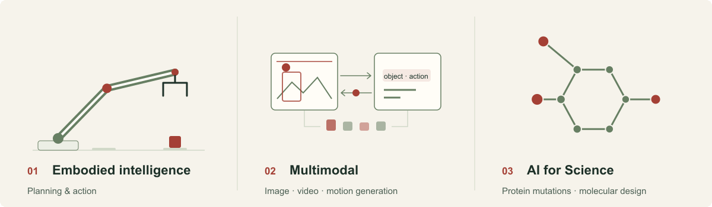

<strong>English</strong> &nbsp; / &nbsp; <a href="README.zh-CN.md">简体中文</a>

# AIMIA Lab

  <a href="https://aimia-eai.github.io/"><strong>Lab website ↗</strong></a> &nbsp;&nbsp; · &nbsp;&nbsp;
  <a href="https://aimia-eai.github.io/research/">Research outputs</a> &nbsp;&nbsp; · &nbsp;&nbsp;
  <a href="https://aimia-eai.github.io/people/">Team &amp; culture</a> &nbsp;&nbsp; · &nbsp;&nbsp;
  <a href="https://aimia-eai.github.io/join/">Join us</a>

**AIMIA Lab · Peking University Shenzhen Graduate School**, led by [Jie Chen](mailto:jiechen2019@pku.edu.cn). Our research focuses on embodied intelligence, multimodal learning and AI for Science.

## Research directions

<picture>
  <source media="(prefers-reduced-motion: reduce) and (prefers-color-scheme: dark)" srcset="assets/research-en-dark.svg">
  <source media="(prefers-reduced-motion: reduce)" srcset="assets/research-en-light.svg">
  <source media="(prefers-color-scheme: dark)" srcset="assets/research-en-dark.gif">
  
</picture>

- **01 · Embodied intelligence**: Agent planning with native-action agents / VLA models, connecting planning, execution and environment feedback.
- **02 · Multimodal**: Image generation and editing, video generation, human motion generation, vision-language understanding and visual grounding.
- **03 · AI4S**: Protein mutation effect prediction, structure and function modelling, molecular generation and design, virus evolution prediction and medical image analysis.

[Explore our research outputs →](https://aimia-eai.github.io/research/#results)

## Open-source list

- **[RT-DETRv4](https://github.com/AIMIA-EAI/RT-DETRv4)** · ECCV 2026 · Real-time object detection · [Paper](https://arxiv.org/abs/2510.25257) · [Issues](https://github.com/AIMIA-EAI/RT-DETRv4/issues)

[All public repositories →](https://github.com/orgs/AIMIA-EAI/repositories)

## Contact & join

[Jie Chen · jiechen2019@pku.edu.cn](mailto:jiechen2019@pku.edu.cn) · [Team & culture](https://aimia-eai.github.io/people/) · [Join us](https://aimia-eai.github.io/join/)

---

AIMIA Lab · School of Electronic and Computer Engineering Peking University Shenzhen Graduate School

<a href="README.zh-CN.md">阅读中文版 →</a>

