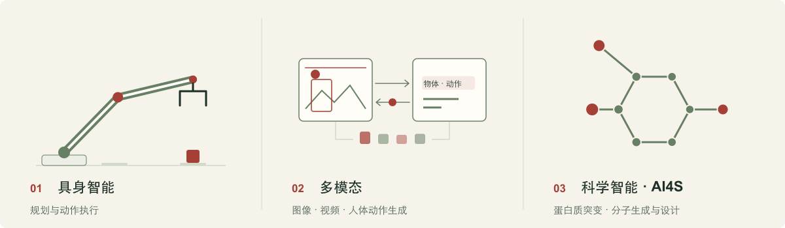

<a href="README.md">English</a> &nbsp; / &nbsp; <strong>简体中文</strong>

# AIMIA 实验室

  <a href="https://aimia-eai.github.io/zh/"><strong>实验室主页 ↗</strong></a> &nbsp;&nbsp; · &nbsp;&nbsp;
  <a href="https://aimia-eai.github.io/zh/research/">研究成果</a> &nbsp;&nbsp; · &nbsp;&nbsp;
  <a href="https://aimia-eai.github.io/zh/people/">团队建设</a> &nbsp;&nbsp; · &nbsp;&nbsp;
  <a href="https://aimia-eai.github.io/zh/join/">加入我们</a>

**AIMIA 实验室 · 北京大学深圳研究生院**，由[陈杰](mailto:jiechen2019@pku.edu.cn)老师负责，聚焦具身智能、多模态与 AI4S。

## 研究方向

<picture>
  <source media="(prefers-reduced-motion: reduce) and (prefers-color-scheme: dark)" srcset="assets/research-zh-dark.svg">
  <source media="(prefers-reduced-motion: reduce)" srcset="assets/research-zh-light.svg">
  <source media="(prefers-color-scheme: dark)" srcset="assets/research-zh-dark.gif">
  
</picture>

- **01 · 具身智能**：Agent 规划器 + Agent 原生动作器 / VLA，连接任务规划、动作执行与环境反馈。
- **02 · 多模态**：图像生成与编辑、视频生成、人体动作生成、视觉语言理解与视觉定位。
- **03 · AI4S**：蛋白质突变效应预测、结构与功能建模、分子生成与设计、病毒演化预测、医学影像分析。

[浏览研究成果 →](https://aimia-eai.github.io/zh/research/#results)

## 开源列表

- **[RT-DETRv4](https://github.com/AIMIA-EAI/RT-DETRv4)** · ECCV 2026 · 实时目标检测 · [论文](https://arxiv.org/abs/2510.25257) · [Issues](https://github.com/AIMIA-EAI/RT-DETRv4/issues)

[全部公开仓库 →](https://github.com/orgs/AIMIA-EAI/repositories)

## 联系与加入

[陈杰 · jiechen2019@pku.edu.cn](mailto:jiechen2019@pku.edu.cn) · [团队建设](https://aimia-eai.github.io/zh/people/) · [加入我们](https://aimia-eai.github.io/zh/join/)

---

AIMIA 实验室 · 信息工程学院 北京大学深圳研究生院

<a href="README.md">Read in English →</a>

